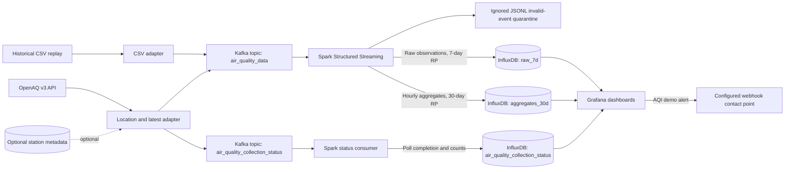
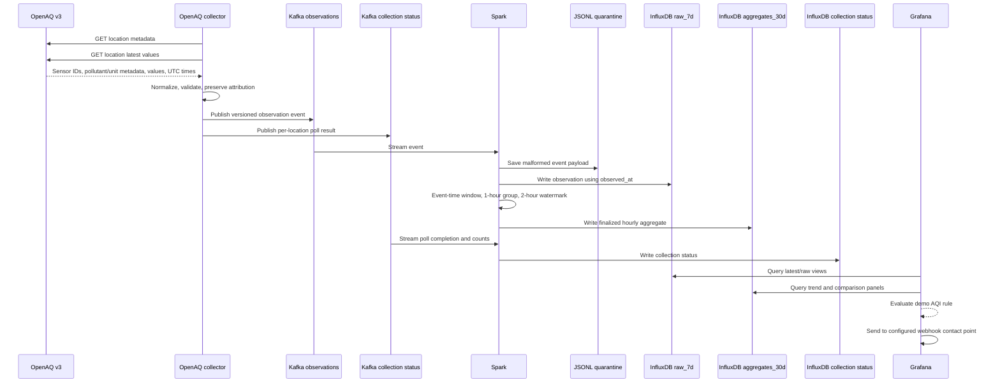

# Architecture and Data Flow

## System architecture

The CSV path is a replay for pipeline demonstrations. It carries an AQI metric without a measured observation timestamp. OpenAQ observations use physical concentration units and source-provided UTC timestamps. The two metric types remain distinct in the canonical event and in InfluxDB tags.

## Event data flow

## Operational boundaries

- OpenAQ access requires an API key. The collector polls only explicitly configured location IDs and does not represent total global coverage.
- The API's latest resource may not capture measurements ingested out of time order.
- The demo AQI rule is not an official health warning. Select the correct AQI standard before using any threshold operationally.
- Docker resource caps apply to Compose containers. Spark currently runs as a host process and needs its own measured JVM budget.
- Historical raw data retention beyond the InfluxDB policies belongs in a separate archive, not in the 7-day raw retention policy.
- Measurement freshness (`ingested_at - observed_at`) and collector freshness (`poll_completed_at`) are separate metrics; a new poll does not guarantee a new measurement.
